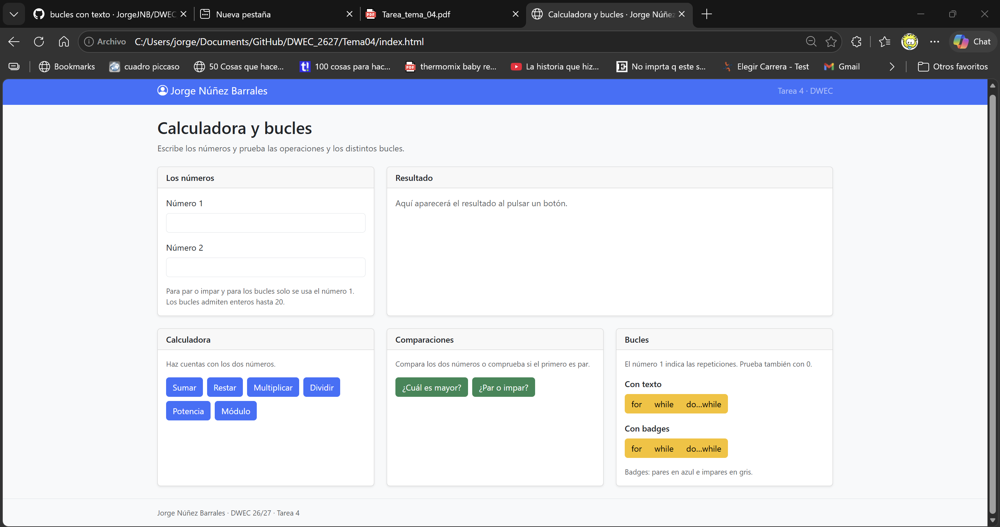
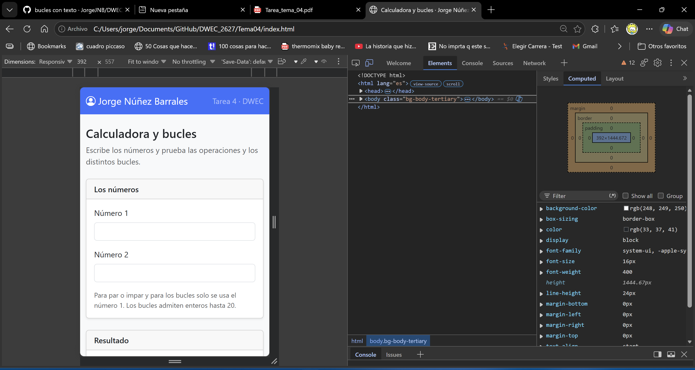
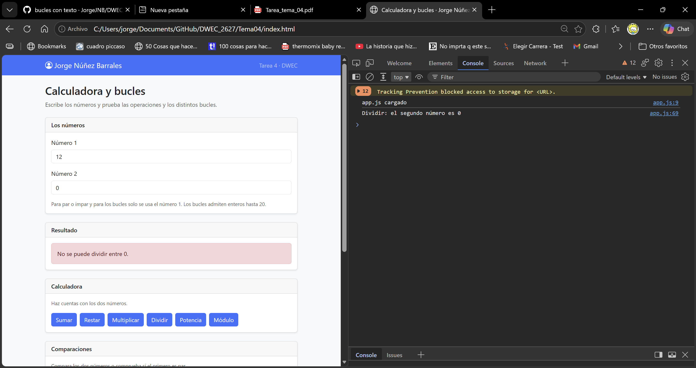
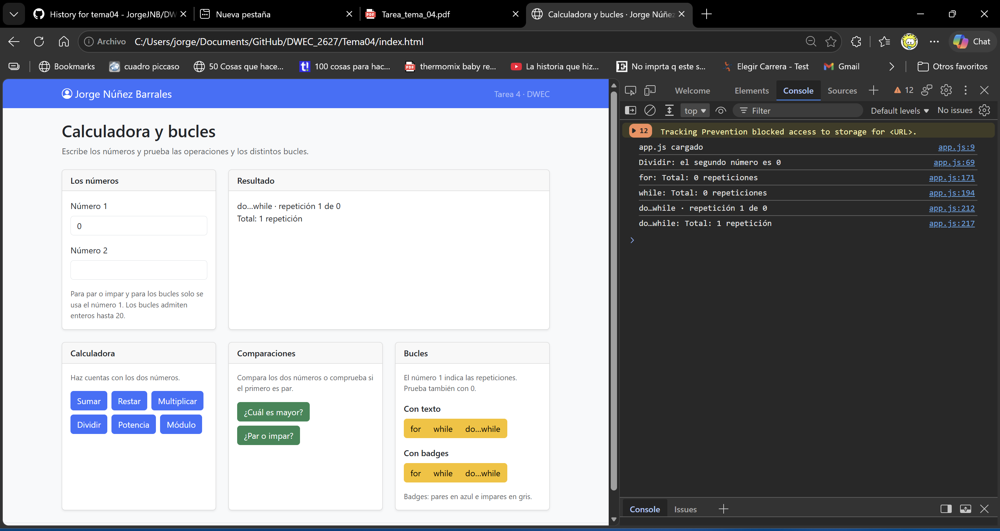
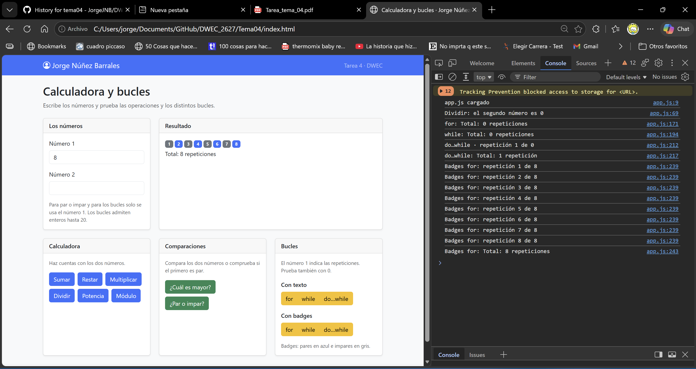

# Tarea 4 · Calculadora y bucles

**Autor:** Jorge Núñez Barrales · DWEC · 2.º DAW · Curso 2026-27

Esta página sirve para hacer cuentas con dos números y probar cómo funcionan los bucles. 

La calculadora tiene suma, resta, multiplicación, división, potencia y módulo. Si falta algún número o intento dividir entre cero, aparece un aviso. También puedo comparar los números y saber si el primero es par o impar. Los bucles usan solo el número 1 y permiten enteros hasta 20.

## Capturas

### a) La página entera

Mi nombre aparece arriba y en el pie. Las tarjetas separan los números, el resultado y los ejercicios.

### b) La página en el móvil

En una pantalla pequeña las tarjetas quedan una debajo de otra para poder usarlas sin tener que desplazarme hacia los lados.

### c) El error de dividir entre 0

Con 12 y 0 aparece un aviso rojo. La consola indica que el segundo número es cero.

### d) Los tres bucles con el número 0

Con 0, for y while hacen cero vueltas. do while hace una, y los tres totales quedan en la consola.

### e) Un bucle con badges

Con 8 aparecen ocho badges: los pares en azul y los impares en gris. Debajo está el total.

## Reflexión

Con for tengo el inicio, la condición y el aumento juntos.  
Lo usaría cuando sé cuántas vueltas quiero dar.  
while comprueba la condición antes de entrar.  
Me sirve cuando quiero repetir algo mientras se cumpla una condición.  
do while comprueba la condición después, así que siempre entra una vez.  
Por eso, con 0, for y while no entran y do while sí.  
Con un número negativo pasa lo mismo.

## Uso de IA

He usado ChatGPT para entender el código, y agilizar un poco la tarea, comprobar codigo y guiarme paso a paso en la tarea. 
