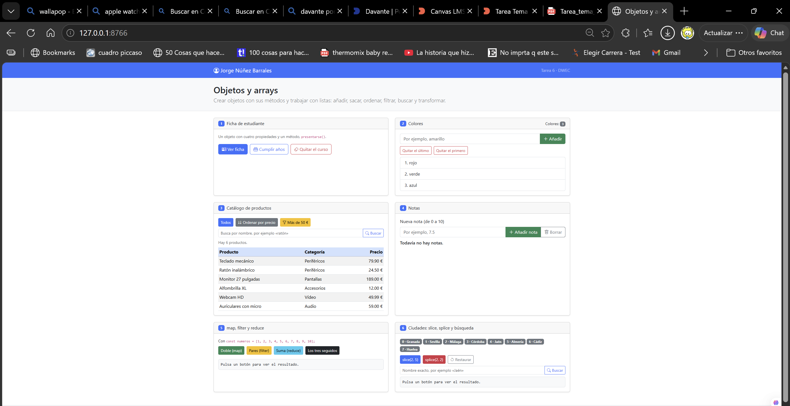
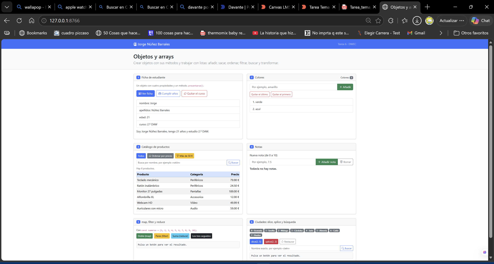
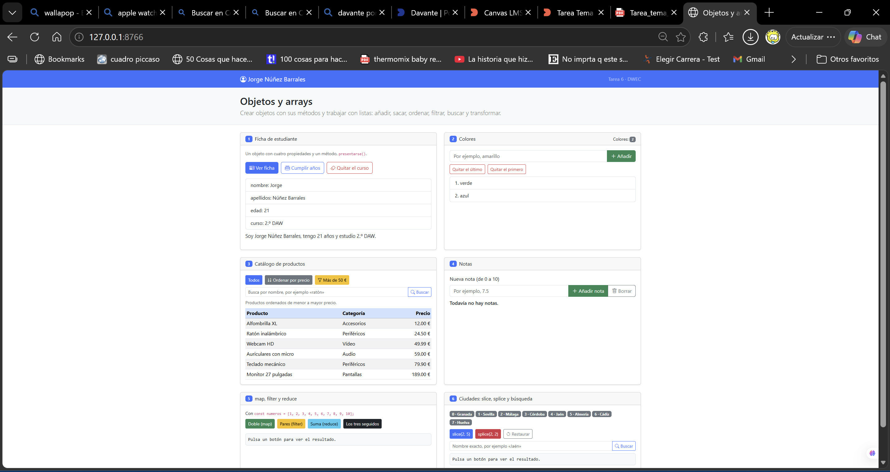
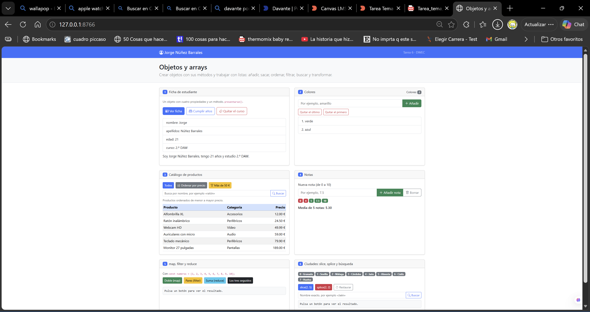
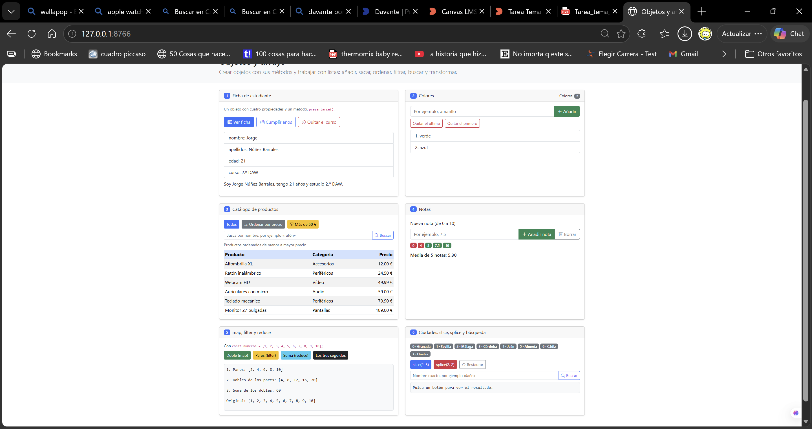
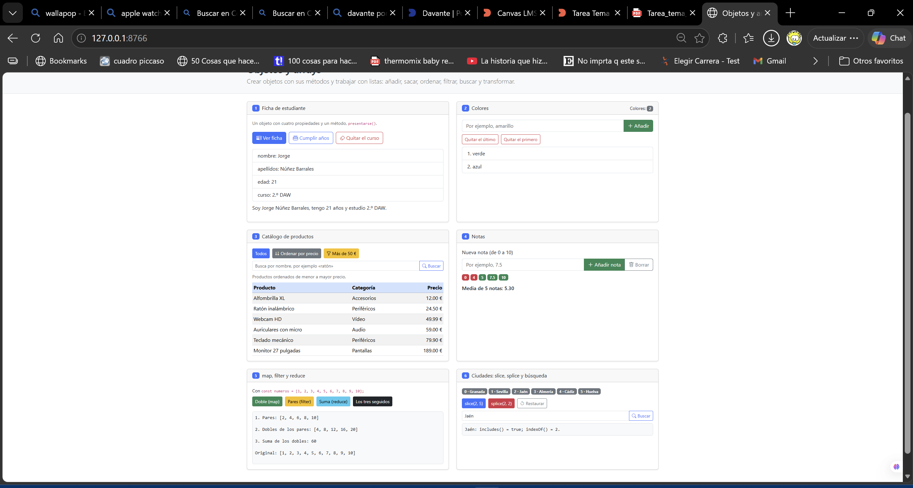

Tarea 6 · Objetos y arrays

**Jorge Núñez Barrales · 2.º DAW · DWEC · Curso 2026-27**

La pagina tiene seis ejercicios para practicar con objetos y listas. Para probarla, abrimos `index.html` en el navegador y pulsamos los botones. Con F12 se podemos ver también los mensajes de la consola.

## Capturas

### a) Página recién cargada

Se ven mi nombre, los tres colores iniciales, los seis productos y las ocho ciudades.

### b) Ficha y colores

La edad pasa de 20 a 21 al cumplir años. Con `push` añadí amarillo, con `pop` quité el último color y con `shift` el primero; quedan verde y azul.

### c) Catálogo ordenado

Los productos aparecen del más barato al más caro. Para ordenarlos comparo sus precios con `a.precio - b.precio`, usando una copia para conservar el orden inicial.

### d) Notas y media

Añadí las notas 0, 4, 5, 7,5 y 10: los suspensos salen en rojo y los aprobados en verde. La media es 5,30 y aparece con dos decimales.

### e) Los tres pasos

Primero quedan los pares, después se duplican y finalmente se suman. El resultado es 60 y la lista original sigue igual.

### f) Ciudades

Después de quitar Málaga y Córdoba con `splice`, quedan seis ciudades. Al buscar Jaén, aparece en la posición 2; antes estaba en la 4.

## Reflexión

`push`, `pop`, `shift`, `sort` y `splice` cambian la lista sobre la que trabajan.\
`slice`, `map` y `filter` devuelven otra lista.\
`reduce` sirve aquí para obtener una suma, sin cambiar los números.\
En las ciudades, `slice(2, 5)` copia tres nombres y siguen quedando ocho.\
`splice(2, 2)` quita Málaga y Córdoba, por lo que quedan seis.\
Por eso ordeno una copia de los productos: al pulsar «Todos» se conserva el orden inicial.\
Al borrar el curso con `delete`, aparece `undefined` porque esa propiedad ya no existe.

## Fuentes

- [Plantilla de la asignatura](https://github.com/DRodero/DWEC_2627).
- [MDN: sort](https://developer.mozilla.org/es/docs/Web/JavaScript/Reference/Global_Objects/Array/sort).
- [MDN: slice](https://developer.mozilla.org/es/docs/Web/JavaScript/Reference/Global_Objects/Array/slice).
- [MDN: splice](https://developer.mozilla.org/es/docs/Web/JavaScript/Reference/Global_Objects/Array/splice).

## Uso de IA

He usado IA para agilizar un poco la tarea, comprobar que los ejercicios estuviesen bien y ayudarme un poco paso a paso.
